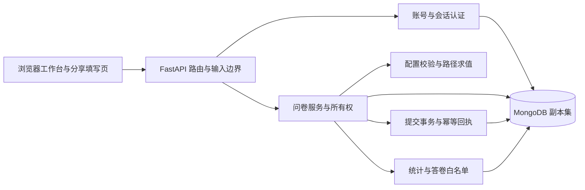

# 第一阶段系统说明

本系统是使用 MongoDB 的简化在线问卷工作台，支持账号、本人问卷管理、四类题目、可配置校验和跳转、登录填写、成功答卷保存及自动统计。当前只实现《大作业一第一阶段》的初始需求。S6 已完成 26 组用例验收，S7 正在整理交付；阶段状态以 [progress.json](../progress.json) 为准。

本文件说明实际系统的组成和使用方式。受验业务代码基线为 `e7255c3`，S6 验收记录提交为 `673643d`；S7 文档及交付元数据另行留存，不代表业务代码重新测试。详细设计与结果分别见 [数据库设计](DATABASE.md)、[API 契约](API.md)、[关键逻辑](LOGIC.md)、[测试报告](TEST_REPORT.md)。

## 1. 用户与权限

同一个账号可以创建自己的问卷，也可以填写他人分享的问卷。系统没有单独的管理员角色。注册保存用户名、密码哈希及注册时间；注册后需要登录。登录成功取得 HttpOnly、SameSite=Strict 的会话 Cookie，会话摘要及过期时间存于 MongoDB；退出会撤销会话。用户名去除首尾空格并按 casefold 规范化判重。

创建者只能查看和管理自己创建的问卷。服务端通过问卷 ID 与当前用户 ID 的联合查询检查所有权，覆盖列表、详情、保存、发布、截止、关闭、统计和明细；获得别人问卷的 ID 不会获得管理权限。管理越权统一返回 404，未登录返回 401。

填写者通过 `/survey/{share_code}` 进入。分享链接只是访问入口，填写仍须登录。“对创建者匿名”表示创建者的结果中看不到填写者账号和私有判重标识；服务端仍保存私有身份以验证重复提交并计算去重人数。非匿名问卷会在填写前提示创建者可查看账号。

## 2. 创建者操作

1. 打开工作台首页，注册并登录，点击“新建问卷”，输入标题和说明。系统创建草稿；默认对创建者匿名、每账号只允许成功提交一次。
2. 在草稿中添加单选、多选、文本或数字题，编辑题目、选项、是否必答及相应限制。选项与题目使用稳定 ID，显示文字不承担关联键的作用。
3. 添加条件跳转：选择来源题、条件、位于其后的目标题及优先级。多选可选 ANY/ALL；数字可选相等或大小比较。同一来源题优先级不能重复，数值越小越先判断。
4. 保存草稿。保存携带当前 revision；如果其他页面已改动，系统返回冲突，须重新读取后处理，不能用旧内容静默覆盖新内容。
5. 发布后复制分享链接。发布会重新校验整卷配置并冻结唯一的 `version=1` 快照；之后不能修改题目、规则、标题说明及匿名/重复策略，也不能再次发布。
6. 发布后可调整截止时间或关闭问卷。界面时间为北京时间，数据库按 UTC 保存；关闭后不重开，调整截止也不会重开已关闭问卷。
7. 在“回答与统计”查看整卷、单题或答卷明细。界面分别展示成功提交份数与去重填写人数；关闭问卷不会删除或隐藏已有结果。

保存和发布前应确认匿名及重复策略符合调查需要。截止时间须是带时区的 ISO 时间或空值，数字时间戳、布尔值等输入不会被隐式当作日期接受。空草稿可以保存，空卷不能发布。

## 3. 填写者操作

1. 打开分享链接并登录，阅读标题、说明、匿名范围及重复填写提示。
2. 按页面当前题目填写。页面调用服务端 `/next` 校验已答部分、计算路径和下一题；错误会显示在相应题目。
3. 可选题可以主动跳过。必答仅约束实际可达题，被规则跳过的必答题不要求补答。
4. 返回修改早期答案时，页面清除其后旧答案，再由服务端重新计算路径。不能把旧分支答案直接带入新分支。
5. 完成后核对预览并确认提交。提交前答案只在当前页面中，不自动保存未完成草稿；刷新或离开可能丢失未提交内容。
6. 成功后显示答卷回执。如果请求结果不确定，页面保留同一请求编号与答案快照，锁定改答并提供重试，以确认同一次提交。重试不会主动另存一份。允许多次填写时，新一轮填写另生成请求编号。

页面保护了通常的重试和账号切换流程；真实断网、所有多窗口切换时序尚未穷尽验证。若登录已过期，按提示重新登录后确认原次提交结果；不要为了重试而人为更换请求编号。

## 4. 系统结构与源码

浏览器使用原生 HTML、CSS 和 JavaScript；FastAPI 提供 JSON API 和静态文件。当前首页由 `FileResponse` 返回 `index.html`，没有采用现成问卷系统框架。依赖清单包含 Jinja2，但当前页面入口不依赖服务端模板渲染。业务持久数据与服务端会话全部存入真实 MongoDB。

- [main.py](../survey_app/main.py)：应用生命周期、路由、同源检查、1 MiB 请求体上限、错误响应及静态页面入口。
- [models.py](../survey_app/models.py)、[errors.py](../survey_app/errors.py)：请求形状、严格字段与业务错误；错误不回显密码、连接串或堆栈。
- [security.py](../survey_app/security.py)：带独立盐的 scrypt 密码哈希、会话 token 摘要、显式过期检查与公开用户字段。
- [service.py](../survey_app/service.py)：账号、本人问卷列表、草稿 revision、发布快照、截止/关闭和功能调度。
- [questions.py](../survey_app/questions.py)：题目与规则配置检查、统一答案校验、部分/完整路径求值及 BSON 大小限制。
- [submissions.py](../survey_app/submissions.py)：规范化内容摘要、幂等回执、事务受理 gate 与完整答卷写入。
- [statistics.py](../survey_app/statistics.py)：拥有者检查、当前发布版本快照读取、Python 统计及答卷白名单。
- [db.py](../survey_app/db.py)、[config.py](../survey_app/config.py)：MongoDB 客户端、集合字段校验、索引及项目配置。
- [index.html](../survey_app/templates/index.html)、[app.js](../survey_app/static/app.js)、[app.css](../survey_app/static/app.css)：登录、管理、逐题填写、回改、提交、结果及错误反馈界面。

服务端不信任浏览器上报的拥有者、填写者、路径、规则或统计。浏览器有交互辅助，最终保存仍重新使用发布配置校验完整路径。

## 5. 数据与一致性

`users` 存账号，`sessions` 存会话摘要，`surveys` 存拥有者和生命周期，`survey_versions` 存不可变发布配置，`responses` 每份成功答卷一个文档。题目、选项、约束和规则内嵌在同一快照；答卷通过稳定 ID 引用问卷与题目，避免把持续增长的答卷数组嵌入问卷。

草稿编辑使用 revision 条件更新；发布事务同时改变问卷状态并写入快照。成功提交的事务对问卷做实际条件写入：状态为 published、版本匹配，且截止为空或严格大于数据库 `$$NOW`；更新 gate 序号及受理时间，再插入答卷。关闭、截止更新也写同一个问卷文档，以写竞争确定先后。部署必须支持事务，本实验使用单节点副本集，未将 standalone 当作可用事务环境。

禁重复与重试由两种唯一约束分工：`survey_id+respondent_id+request_id` 防止同一次请求重复保存；仅对 `single_submission=true` 生效的账号/问卷条件唯一索引限制每人一次。允许重复的答卷不受后一索引限制。同编号同规范内容返回原回执，即使后来关闭也可重放；同编号异内容冲突，新编号仍受重复开关和生命周期约束。

统计先验证拥有者，在 snapshot 事务中一次读取本问卷当前版本答卷，随后在 Python 对固定结果集计算，不维护文件或可失真的统计副本。单选返回每选项次数和人数，多选每份答卷每个选项最多计一次；文本与数字提供原文数组，数字均值排除空答及跳过，无有效数值返回 null。匿名明细只返回显式允许的字段，非匿名才额外返回 username。

## 6. 配置、启动与错误处理

Lab4 是运行根目录，完整安装与启动命令以 [README](../../README.md) 和 [环境说明](ENVIRONMENT.md) 为准。Python 依赖从 `environment.yml` 使用 conda 创建，不使用 pip。`scripts/configure_env.py` 从示例生成本地 `.env` 和随机会话密钥，已有文件不覆盖；操作系统环境变量优先于 `.env`。`SESSION_SECRET` 不能保留示例占位符。

本地默认 MongoDB 绑定回环地址27084、副本集lab4rs、业务库lab4_survey，应用HTTP端口8004；数据目录为当前项目的`.runtime/mongo`。初始化脚本核对实际目录归属，不清空业务数据，也不使用旧Lab的27017。`.env`、`.runtime`、conda环境和缓存不属于提交物。

最小启动顺序是激活环境、生成配置、启动独立MongoDB、初始化副本集和Schema，再运行 `python -m uvicorn survey_app.main:app --host 127.0.0.1 --port 8004`。正常停止应用使用Ctrl+C；停止数据库前核对进程及目录属于本项目，保留数据。切换端口或副本集时必须同时更新启动参数、初始化参数和连接配置。

常见响应：401表示需登录；403表示拒绝跨站写入；404表示不存在或无管理权限；409表示状态、revision、重复填写或幂等冲突；410表示已关闭/到期；422表示输入、配置、路径或大小不合法；503表示数据库暂不可用。先按错误提示修正，不删除数据或修改服务器配置来绕过拒绝。

## 7. 验证与边界

S6已核对业务24组、浏览器E01、环境复现E02共26组。业务基线全量245条调用通过，包含直接校验器单元测试及真实MongoDB API测试；Schema43项独立验证字段与索引。干净源码副本、新conda环境、独立MongoDB及HTTP进程再次通过245条测试、43项Schema和23步HTTP流程，应用PID26896重启为19376后仍能读同一答卷、会话和回执。[测试报告](TEST_REPORT.md)区分各计数及原始证据，不将它们相加作独立用例总数。

第一阶段每卷只发布一次，不提供v2、重开、删除、导出、未完成填写自动保存或第二阶段功能。文本长度按Unicode码点而非视觉字数，手机号若用数字题会丢失前导零，需按实际调查语义选择题型。项目限制为每卷100题、每题50选项、500规则、单条文本10000码点，请求与相关持久文档限制1 MiB；这些是项目决定，不是教师规定。

验收在同一Windows主机完成，干净复现复用了已安装的MongoDB二进制；未承诺新操作系统、其他浏览器/移动端、公网部署、容量或生产性能。10并发是正确性夹具。统计加载可能影响滚动/焦点，手工构造非法百分号分享URL缺少友好处理，详见[代码审阅](../results/acceptance/final-code-review.md)。本地回环HTTP及无认证MongoDB仅用于实验，公网环境需要另行设计与验证。

统计与答卷明细按当前发布版本一次返回该问卷的全部答卷，没有分页或条数上限（请求方向限制1 MiB，响应方向未限制）；统计与明细也不接受版本参数。第一阶段每卷一次发布、数据量为课程规模，这两点不构成问题，但第二阶段引入多版本或大答卷量前需要先补分页与版本口径。另有两处口径属项目自行采纳、**未经教师确认**：未完成的填写不落库（只保存每次成功提交），以及“匿名”指对创建者隐藏账号而填写者仍须登录；详见 [第一阶段报告](REPORT_STAGE1.md) 第 5.1 节。
