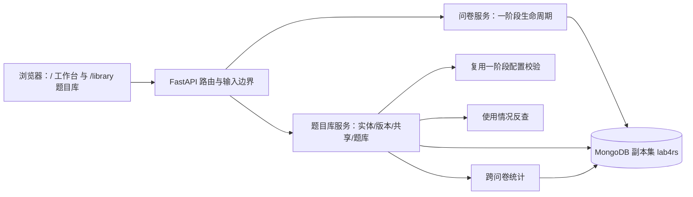

# 第二阶段系统说明

本系统是一阶段问卷工作台的第二阶段扩展：在一阶段“账号 / 问卷 / 四类题型 / 校验与跳转 / 发布填写 / 提交统计”之上，增加**可复用题目库**——题目作为独立实体保存、内容按不可变版本演进，可共享给其他用户、可组织成题库、可查看被哪些问卷使用，并可按题目维度做跨问卷统计。阶段依据是《大作业一：需求变更》的八项变更（R15–R22），一阶段功能不重写，契约见一阶段文档 `Lab4-1/docs/`。

仓库按两阶段组织：`Lab4/` 根目录放两阶段共用的 [AGENTS.md](../../AGENTS.md)、[WORKFLOW.md](../../WORKFLOW.md)、[README.md](../../README.md)，一阶段在 `Lab4-1/`，二阶段在 `Lab4-2/`。二阶段的步骤与门禁为 T0–T7（见 WORKFLOW 第 13 节），状态以 [progress.json](../progress.json) 为准，逐门禁记录在 `results/stage2/gates-t0.md` 至 `gates-t7.md`。

本文件说明实际系统怎么用、跑起来需要什么命令、哪些已经验证、哪些没有。

## 1. 用户与权限

系统没有管理员角色，只有四类身份：

| 身份 | 能做什么 | 不能做什么 |
| --- | --- | --- |
| 未登录 | 打开 `/library` 页面外壳（脚本显示登录提示） | 读写任何题目数据 |
| 登录用户（所有者） | 创建题目、追加版本、恢复、共享/取消共享、加入题库、导入自己的草稿问卷、查看使用情况与全部问卷的跨问卷统计 | 修改他人题目 |
| 被共享者 | 查看题目与版本、导入自己的草稿问卷、另存为自己的新题目、查看使用情况、只看自己问卷的跨问卷统计 | 追加版本、恢复、共享、改题库（这些入口返回 404） |
| 其他登录用户 | 无 | 题目、题库、版本全部 404 |

题目与题库的所有权都在服务端按 `owner_id` 判定，知道 ID 不会获得权限；越权用 404，只有“问卷修订里题目存在但不是所有者”用 403。题库永远私有，共享只针对题目。

## 2. 页面与入口

系统只有两个页面入口，都是原生 HTML/CSS/JavaScript，由 FastAPI 的 `FileResponse` 返回：

| 路径 | 文件 | 内容 |
| --- | --- | --- |
| `/`、`/survey/{code}` | [index.html](../survey_app/templates/index.html) | 一阶段的登录、问卷管理、填写、回执与统计 |
| `/library` | [library.html](../survey_app/templates/library.html) | 第二阶段的题目库：新建题目、我的/共享给我、详情、版本历史、恢复、共享、题库、加入问卷、跨问卷统计 |

`/library` 复用一阶段的 `app.css` 设计令牌，另加 [library.css](../survey_app/static/library.css) 与 [library.js](../survey_app/static/library.js)；没有引入前端框架，也没有改动一阶段的 `app.js`。页面顶部导航在“我的问卷 / 题目库”之间切换。

未登录访问 `/library` 时页面外壳仍返回 200，但脚本调用 `/api/auth/me` 得到 401，于是只显示“登录后管理题目库”面板和回首页的链接；所有数据接口都需要会话。

## 3. 题目库使用流程

### 3.1 创建与浏览题目

1. 打开 `/library`，在左侧“新建题目”选择题型（单选/多选/文本/数字），填题干；选择题可增删选项（最多 50 个），数字题可设最小/最大/只允许整数，文本题可设最短/最长长度；可勾“默认必答”，可写“修改说明”（进入版本历史）。
2. 点“保存到题目库”，成功后清空表单并刷新列表；失败在表单下方显示服务端错误信息（例如单选题只给一个选项会被拒）。
3. 右侧列表分“我的题目 / 共享给我的”两个标签；可按题干搜索（仅“我的题目”）。每张卡片显示题型、当前版本、所在题库数、共享人数。

### 3.2 从题目库到问卷

1. 点开一道题，详情区显示当前版本内容、版本历史、被哪些问卷使用、加入题库/共享入口（仅所有者）、修改入口与“查看跨问卷统计”。
2. 在“加入我的草稿问卷”里选一份草稿问卷与要钉住的版本，点“加入问卷”。服务端把该版本内容复制进草稿并记 `question_version`；返回的问卷 revision 已递增。
3. 回到 `/` 继续编辑问卷、发布。发布后该题在本卷冻结，后续题目库里的改版不会影响它。

### 3.3 改题：三种模式

草稿问卷里改一道来自题目库的题时，页面与服务端提供三种方式（对应 `POST /api/surveys/{id}/questions/{qid}/revision`）：

| 模式 | 适用 | 结果 |
| --- | --- | --- |
| 只改本卷（`draft_only`） | 任何草稿题 | 本卷内容改变，脱离题目库，不再计入该题目的跨问卷统计 |
| 保存为新版本（`new_version`） | 本人拥有的题目 | 题目库新增一版，本卷指向新版，旧问卷仍钉旧版 |
| 另存为新题（`fork`） | 本人拥有或被共享的题目 | 生成一道新题目，本卷换成新题，引用旧题号的跳转规则自动改写 |

被共享者对他人题目只能用只改本卷或另存为新题；强行请求“保存为新版本”得到 403。

### 3.4 版本历史与恢复

详情区的“版本历史”按版本号列出每条：版本号、修改说明、改自哪一题哪一版（`derived_from`）、恢复自哪一版（`restored_from`）。所有者可对任意非当前版本点“恢复此版本”；服务端不是回滚，而是以该版本内容**新增**一个版本，当前版本号继续加一。因此历史永远只增不减，旧问卷引用的版本内容也不会被改写。

### 3.5 共享

所有者输入对方用户名点“共享”，对方立刻能在“共享给我的”里看到该题并导入自己的问卷。共享不复制内容、不转移所有权；所有者可随时“取消共享”，之后对方再访问该题得到 404，但对方此前已导入问卷的副本不受影响（副本是快照）。

### 3.6 题库

左侧“题库”面板可新建题库（同名会被拒）。在题目详情的“加入题库”里把当前版本加入题库；题库列表显示每题的钉住版本，若题目已升版则显示“v1 → 最新 v3”的提示与“更新版本”按钮，点它把条目显式更新到当前版本（也可通过接口指定版本）。题库只属于自己，别人看不到。

### 3.7 使用情况与跨问卷统计

- “被哪些问卷使用”来自两个数组的反查：草稿问卷行标“草稿/可改”，已发布行标“已发布（已冻结）/不可改”，并显示问卷版本与题目版本；没有使用记录时显示“还没有问卷使用这道题”。
- “查看跨问卷统计”按题目聚合已发布问卷的答卷：显示范围（全部问卷 / 仅我自己的问卷）、问卷数与有效回答数、按题型的总分布、按题目版本的分桶、按问卷的明细。文本题列出原值（最多 200 条），数字题给均值与有效数值个数。

## 4. 系统结构与源码



| 文件 | 职责 |
| --- | --- |
| [library.py](../survey_app/library.py) | 题目实体、版本演进、共享、题库、使用情况、跨问卷统计、导入与修订 |
| [db.py](../survey_app/db.py) | 五个新集合的 strict/error 校验与 19 个索引（10 个集合） |
| [main.py](../survey_app/main.py) | 22 条新路由、`/library` 页面、既有一阶段路由 |
| [models.py](../survey_app/models.py) | 新请求模型，`extra='forbid'`；`BankVersionInput` 用于题库条目改钉版本 |
| [service.py](../survey_app/service.py) | 草稿保存前调用 `normalize_question_refs`；发布冻结不变 |
| [questions.py](../survey_app/questions.py) | 题目/规则/答案校验；接受并校验 `question_version` |
| [library.html](../survey_app/templates/library.html)、[library.js](../survey_app/static/library.js)、[library.css](../survey_app/static/library.css) | 题目库页面 |

## 5. 数据与一致性

题目身份在 `questions`，内容在不可变 `question_versions`，授权在 `question_shares`，题库在 `question_banks` 与 `question_bank_items`；一阶段的 `surveys`/`survey_versions`/`responses` 结构未改，只在题目副本上多了一个可选 `question_version`。题目内容的复制与版本标记、使用情况的反查、跨问卷统计的聚合规则见 [DATABASE.md](DATABASE.md) 与 [LOGIC.md](LOGIC.md)。

新建题目与追加版本在事务中完成；共享、题库、题库条目是单文档写入，唯一性由数据库索引保证（重复共享/重复入库/题库重名都是 409）。

## 6. 配置、启动与迁移

全部命令在 `Lab4-2/` 目录内执行（根目录 README 的“第二阶段”一节给出同样的顺序）。依赖用 conda 管理，不用 pip；权威文件是 [environment.yml](../environment.yml)（`lab4-survey`，Python 3.11.17、FastAPI 0.143.1、PyMongo 4.19.0、pytest 9.1.1）。已验证的环境证据见 [results/stage2/environment.json](../results/stage2/environment.json)：MongoDB 6.0.29、副本集 `lab4rs`、端口 27084、事务探针 PASS。

```powershell
cd Lab4-2
conda env create --file environment.yml --yes     # 已有同名环境时用 conda env update --file environment.yml
conda activate lab4-survey
python scripts/configure_env.py                   # 从 .env.example 生成 .env 与随机会话密钥，已有文件不覆盖
.\scripts\start_mongo.ps1                         # 127.0.0.1:27084，副本集 lab4rs，数据目录 .runtime/mongo
python scripts/init_mongo.py --output results/stage2/environment.json
python scripts/init_db.py                         # 建/同步 10 个集合、19 个索引与字段校验，不清库
python -m uvicorn survey_app.main:app --host 127.0.0.1 --port 8004
```

打开 http://127.0.0.1:8004/ 使用一阶段工作台，http://127.0.0.1:8004/library 使用题目库，http://127.0.0.1:8004/health 检查应用与数据库连通。配置从 `.env` 读取，环境变量优先；`.env`、`.runtime/`、缓存与 conda 环境不属于提交物。

一阶段数据迁移（只补题目实体，不改写问卷文档）：

```powershell
python scripts/migrate_question_library.py --dry-run    # 只统计，不写库；报告默认写 results/stage2/migration.json
python scripts/migrate_question_library.py --apply      # 补建 questions + question_versions，可重复执行
```

迁移的判定与跳过规则见 [LOGIC.md](LOGIC.md) 第 9 节。仓库中已落盘的 [migration.json](../results/stage2/migration.json) 是对已含实体的库执行 `--apply` 的结果（`created=0`、`skipped_existing=2`），用于证明幂等，不代表首次回填。

验证命令：

```powershell
python -m pytest tests --evidence results/stage2/pytest.json -q
python scripts/check_schema.py --output results/stage2/schema-check.json
python scripts/check_workflow.py
```

测试会新建 `lab4_test_api_<uuid>` 测试库，结束时只删除该精确库名；Schema 检查用 `lab4_test_schema_<uuid>` 库。流程检查器只核对记录结构，不能代替业务验收。

## 7. 已验证与未验证

已核验（证据均为仓库文件）：

| 项 | 结果 | 证据 |
| --- | --- | --- |
| 全量自动化测试 | 260 项收集、260 通过、0 失败、exit 0 | [pytest.json](../results/stage2/pytest.json) |
| 集合/索引/字段校验 | 58 项检查 PASS，10 个集合、19 个索引 | [schema-check.json](../results/stage2/schema-check.json) |
| 真实 HTTP 全链路 | 34 步全 PASS（两名用户、版本/恢复/共享/三份问卷提交/使用情况/统计/题库/fork） | [http-e2e.json](../results/stage2/http-e2e.json) |
| 迁移幂等 | `skipped_existing=2`、`created=0` | [migration.json](../results/stage2/migration.json) |
| 页面可达 | `/library` 与三个静态资源、`/health` 均 200；`library.js` 通过 `node --check` | [gates-t3.md](../results/stage2/gates-t3.md) 与本文档整理时的只读复验 |

未验证：

- 完整交互式浏览器会话（点击、表单、弹窗、恢复/共享/统计面板）没有执行；只做了 HTTP 可达性与脚本语法检查，没有截图。
- 二阶段新接口的并发夹具（同时追加版本、同时共享）没有构造；一致性只由唯一索引与代码路径支持。
- 使用情况与统计的分页、超大数据量表现未测。
- 公网部署、认证/TLS、容量与其他浏览器未覆盖；本地实验使用回环 HTTP 与无认证 MongoDB。
