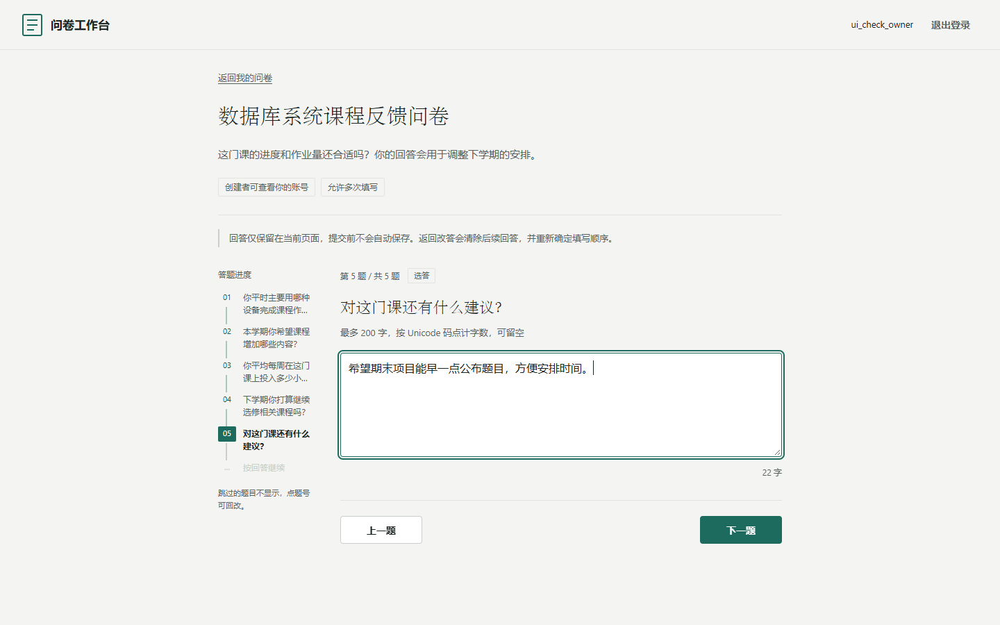
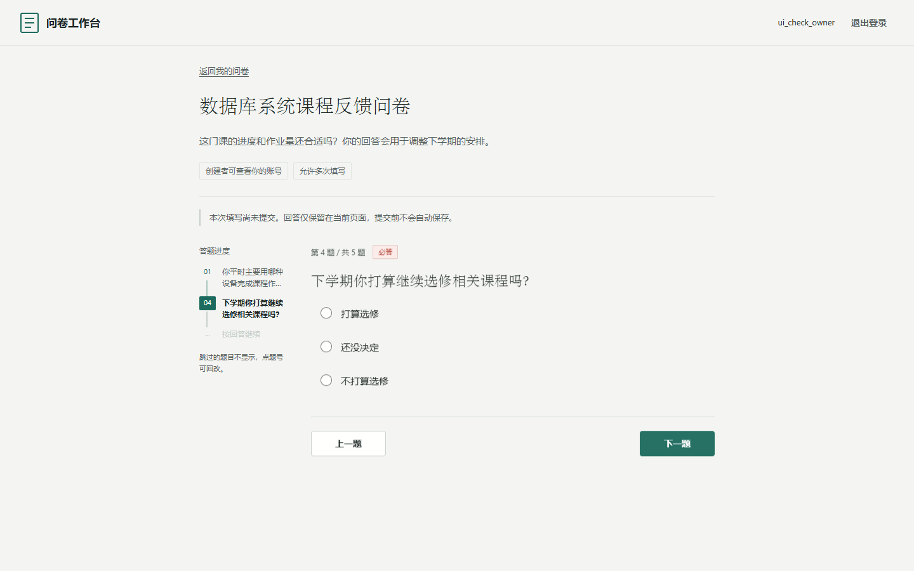

# 数据库课程实验 · MongoDB 在线问卷系统

仓库地址：<https://github.com/oceancat91/DB-Lab>

数据库管理系统课程大作业第一阶段的完整实现：用 MongoDB 做持久化的在线问卷系统，包含账号与所有权隔离、问卷与四类题型的配置、服务端校验与可配置跳转、发布分享、登录后填写与提交，以及按真实数据自动生成的统计，并附真实数据库测试、实验日志与人工智能使用记录。

仓库根目录即项目根目录，按 [WORKFLOW.md](WORKFLOW.md) 与 [AGENTS.md](AGENTS.md) 顺序实施，只覆盖《大作业一第一阶段》。当前 S0–S7 全部验收通过，最近一次改动是 2026-10-16 的填写页面改版；实际状态见 [progress.json](progress.json)，已执行验收结果见 [测试报告](docs/TEST_REPORT.md)。

```powershell
git clone https://github.com/oceancat91/DB-Lab.git
cd DB-Lab
```

## 界面改版（2026-10-16）

填写页面按“纸与墨”重做：问卷标题与题干用宋体系、界面正文用无衬线体系，主色改为松墨绿，朱砂红只保留给“必答”标记与回执编号；答题区左侧新增**答题路径轨**，按真实路径列出已答题目（可点回改）、当前题与“按回答继续”，跳过的题目以题号断档体现。改动只涉及 `survey_app/static/app.css` 与 `survey_app/static/app.js`，服务端、Schema、校验、跳转、提交与统计逻辑未变。





改版前后对比截图、逐项检查与未验证范围见 [改版证据](results/ui-refresh/review.md)；改版过程、设计判断与 AI 记录见 [实验日志](docs/EXPERIMENT_LOG.md) EXP-013 与 [AI 使用记录](docs/AI_USAGE.md) AI-012。

## 功能与语义

注册和登录后，用户创建自己的问卷，配置单选、多选、文本、数字题及校验和条件跳转，再发布分享链接。发布后题目及匿名/重复策略固定，仍可调整截止时间或关闭。填写者必须登录；匿名表示向创建者隐藏账号，服务端保留私有判重身份。

多选支持最少/最多/精确数量，文本按 Unicode 码点计长度，数字检查有限值、范围和整数。跳转来自问卷配置，服务端按唯一优先级选择首条命中规则，只允许向后跳。返回修改早期答案会清除后续回答；最终提交重新校验全部路径。提交前不自动保存草稿。

允许重复填写与网络重试分别处理：新一轮填写使用新请求编号，网络重试复用原编号。MongoDB 事务将问卷受理条件写入与答卷插入绑定，数据库唯一索引处理并发判重。统计区分成功提交次数和去重人数，空答/跳过不补零，匿名结果不返回账号或私有身份。设计细节见 [DECISIONS](docs/DECISIONS.md)。

## 运行

需要 conda、MongoDB 6.0或兼容版本，且 mongod 在 PATH。全部命令在仓库根目录的 PowerShell 执行。Python依赖由 conda 管理，不使用 pip。已验证版本见 [环境说明](docs/ENVIRONMENT.md)。

```powershell
conda env create --file environment.yml --yes
conda activate lab4-survey
python scripts/configure_env.py
.\scripts\start_mongo.ps1
python scripts/init_mongo.py --output results/local-environment.json
python scripts/init_db.py
python -m uvicorn survey_app.main:app --host 127.0.0.1 --port 8004
```

打开 http://127.0.0.1:8004/ ，注册新账号后创建问卷。密码至少8字符。mongod独立绑定127.0.0.1:27084，副本集lab4rs，数据在本目录.runtime/mongo，业务库lab4_survey；没有使用旧Lab的27017服务。初始化会校验实际数据目录归属，不会清空既有数据库。应用在启动时也会检查Schema及索引。

`.env` 由脚本生成随机会话密钥，已有文件不覆盖。配置变量为 MONGODB_URI、MONGODB_DATABASE、SESSION_SECRET、COOKIE_SECURE、SESSION_TTL_SECONDS（会话有效期秒数，默认 86400，同时决定 Mongo 会话文档的 expires_at）；环境变量优先于.env。使用其他端口或副本集时，启动及初始化分别传入 `-Port / -ReplicaSet` 和 `--port / --replica-set`，并同步连接串。本地实验使用HTTP与回环无认证实例，公网部署需要另行配置认证、TLS和访问控制。

本地网页需要应用进程持续运行；若出现 `ERR_CONNECTION_REFUSED`，先确认上述uvicorn命令正在运行，启动后刷新浏览器。可访问 http://127.0.0.1:8004/health 检查应用及数据库连通；重启电脑后需要重新启动本地服务。

停止应用按Ctrl+C。数据库仅在确认是本项目进程后停止；数据保留在.runtime。若已有同名conda环境，使用 `conda env update --file environment.yml`，不要盲目重建环境。

## 验证

另开已激活相同conda环境的PowerShell：

```powershell
python -m pytest tests --evidence results/local-run.json -q
python scripts/check_schema.py --output results/local-schema.json
python scripts/check_workflow.py
```

这三个 `--output/--evidence` 路径是**本地运行产物**：首次执行才会生成（当前仓库里只保留了已执行的 `results/local-run.json`），可以自行改名或换目录，不会覆盖阶段证据。交付物中的固定证据是 `results/S1`、`results/S2` 等阶段文件，以及 `results/acceptance`、`results/stage1-audit` 下的验收与复核记录。

pytest自动新建lab4_test_api_UUID测试库，结束只清理该精确新库。业务数据和会话全部持久化到真实MongoDB，不使用关系数据库或文件替代。流程检查器只核对文档/状态/证据结构，不能代替业务测试。Starlette在固定版本中提示TestClient/httpx兼容路径未来弃用，当前实测正常；浏览器与真实HTTP另行验证。

## 已执行验收

- 第一阶段26组用例全部通过，见 [测试报告](docs/TEST_REPORT.md)。
- 全量245项测试通过；独立新conda环境再次245/245，Schema43/43，23步真实HTTP及应用重启持久化通过；填写页面改版后245项再次通过。
- 浏览器真实验证创建、四类校验、回改跳转、提交回执、匿名明细、整卷/单题统计及关闭；改版另做分支跳题、回改已答题与键盘焦点验证，见 [改版证据](results/ui-refresh/review.md)。
- BSON备份恢复后3份答卷/2人、均值15及原回执一致，见 [恢复证据](results/S7/backup-restore.json)。
- 四种10请求同时起跑用于验证并发正确性；此结果不代表容量或生产性能指标。

复现发生过Windows脚本编码/清理包装器错误，原始失败和补救证据保留；固定依赖的Starlette/httpx弃用warning已解释。详情见 [干净环境复现](results/acceptance/reproduction.md)。

## 项目文件

- `survey_app/`：FastAPI应用、MongoDBSchema、认证、问卷/校验/跳转、提交/统计和原生HTML/CSS/JS页面。
- `tests/`：独立合成数据、真实数据库与并发验收；`scripts/`：环境、MongoDB、Schema及流程工具。
- [需求映射](docs/REQUIREMENTS.md)、[业务决策](docs/DECISIONS.md)、[测试计划](docs/TEST_PLAN.md)。
- [系统与使用说明](docs/SYSTEM.md)、[数据库设计](docs/DATABASE.md)、[API](docs/API.md)、[关键逻辑](docs/LOGIC.md)、[环境](docs/ENVIRONMENT.md)。
- [第一阶段完成报告](docs/REPORT_STAGE1.md)、[测试报告](docs/TEST_REPORT.md)、[基线与恢复说明](docs/BASELINE_STAGE1.md)。
- [实验日志](docs/EXPERIMENT_LOG.md)、[AI使用记录](docs/AI_USAGE.md)及`results/S1`至`results/S7`、`results/acceptance`实际阶段证据。
- [填写页改版证据](results/ui-refresh/review.md)与[S7 快照说明](results/S7/archive/README.md)。
- [源作业Word](大作业一第一阶段.docx)和`references/`来源副本。

`.env`、`.runtime/`、`dist/`、环境、Git内部文件及缓存不属于提交内容，因此克隆后没有本机会话密钥、没有运行时数据库、也没有现成压缩包。`results/Lab4/`是历史重复包，不作为入口或当前交付物；Lab1–Lab3是独立实验，本项目未修改。最终提交四类材料为可运行代码/配置、设计说明、测试用例与真实结果、完整报告；S7交付门禁已通过，详见 [最终门禁](results/S7/gates.md)。

## 打包与已知范围

交付包 `dist/Lab4-stage1.zip` 不入库，克隆后按需在本地生成，解压后入口是Lab4/README.md；同时生成配套 `.zip.sha256` 校验压缩包，`results/S7/manifest.json`记录每个提交文件的实际字节摘要，清单和打包检查记录不对自身递归求摘要：

```powershell
python scripts/package_stage1.py
```

该命令按当前工作树重建压缩包、清单和打包检查，因此每次重建都会得到新的摘要。S7 通过后用户追加了一次填写页面改版（见 [实验日志](docs/EXPERIMENT_LOG.md) EXP-013）：`dist/Lab4-stage1.zip` 已按改版后的工作树重建，改版只动 `survey_app/static/app.css` 与 `survey_app/static/app.js`；S7 时点的包与清单逐字节快照保留在 `dist/Lab4-stage1-s7-baseline.zip`（同样不入库）与 [S7 快照说明](results/S7/archive/README.md)，21 个业务文件的基线复核见 [基线复核](results/ui-refresh/code-baseline-check.json)。

包中保留源Word、规范、代码、文档、真实测试/失败记录及合成夹具；排除本机配置、运行时数据库/备份、Git内部文件、环境和缓存。生产认证/TLS、容量压力、其他操作系统/浏览器与完整移动设备适配未验收。当前统计加载可能使滚动位置变化，人为畸形百分号分享URL尚无友好提示；正常生成链接完整链路已通过，详见 [代码复核](results/acceptance/final-code-review.md)。

## 两阶段仓库结构

本仓库按课程要求分阶段交付，三个阶段要素共用同一份治理文件：

```
Lab4/
├── AGENTS.md      公共：实验行为规范（两阶段共用）
├── WORKFLOW.md    公共：一阶段 S0–S7 与二阶段 T0–T7 的步骤与门禁
├── README.md      公共：本文件
├── Lab4-1/        第一阶段：问卷系统基线（账号、问卷、校验跳转、提交统计）
└── Lab4-2/        第二阶段：可复用题目库（题目实体、版本、共享、题库、跨问卷统计）
```

两个阶段各自含 `progress.json`、`environment.yml`、`survey_app/`、`tests/`、`scripts/`、`docs/` 与 `results/`，
可单独打包：一阶段包 = 三个公共文件 + `Lab4-1/`，二阶段包 = 三个公共文件 + `Lab4-2/`。

## 第二阶段：可复用题目库

依据《大作业一：需求变更》实现八项变更：

1. 题目作为独立实体保存，一份问卷可从已有题目中选择，一题可被多份问卷使用。
2. 题目可共享给其他用户；被共享者可复用，但不能修改原题（只能另存为自己的新题）。
3. 已发布问卷的题目不可修改：修改题目只会生成新版本，旧问卷继续引用旧版本。
4. 题目有版本历史，可查看、可恢复（恢复同样追加新版本，不改写历史）。
5. 同一题目的多个版本可共存，不同问卷可钉住不同版本。
6. 可查看某题被哪些问卷使用（草稿与已发布分开列出，已发布的标注不可改）。
7. 可建立题库并钉住题目版本，题目更新后题库条目可显式更新到新版本。
8. 可按题目维度跨问卷统计答案分布（所有者看全部问卷，被共享者只看自己的问卷）。

数据模型见 [Lab4-2/docs/DATABASE.md](Lab4-2/docs/DATABASE.md)，接口见 [Lab4-2/docs/API.md](Lab4-2/docs/API.md)，
关键逻辑见 [Lab4-2/docs/LOGIC.md](Lab4-2/docs/LOGIC.md)，测试见 [Lab4-2/docs/TEST_REPORT.md](Lab4-2/docs/TEST_REPORT.md)。

```powershell
cd Lab4-2
conda activate lab4-survey
python scripts/init_db.py
python -m uvicorn survey_app.main:app --host 127.0.0.1 --port 8004
# 题目库页面：http://127.0.0.1:8004/library
python scripts/migrate_question_library.py --dry-run   # 一阶段内嵌题目回填，先看报告
python scripts/migrate_question_library.py --apply
python -m pytest tests --evidence results/stage2/pytest.json -q
python scripts/package_stage2.py                       # 生成 dist/Lab4-stage2.zip
```
